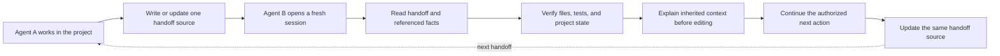
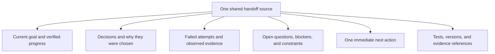

# Cross-Agent Handoff

[中文说明](README.zh-CN.md) · **v0.2.0-rc.1** · MIT · Pre-release candidate. See [validation and limitations](VALIDATION.md).

Cross-Agent Handoff is a lightweight, file-based workflow for passing unfinished work between AI agents. It preserves verified progress, decision rationale, failed attempts, open questions, and one next action in one shared project handoff source—usually `HANDOFF.md`, or an existing state document when the project already has one. The receiving agent checks the real project before editing. The Markdown workflow needs no server or runtime dependency.

## What it is — and what it is not

**It is:** a small, reusable handoff protocol and Skill that helps one agent leave another agent enough verified project context to continue work without replaying the old chat.

**It is not:** full chat-history synchronization, native session migration, a background monitor, a multi-agent orchestrator, or a tool that launches or controls other agents.

Use it when work is paused, handed to another agent, moved to a fresh session, or resumed after a context reset. Keep the handoff in the project's existing source of truth when one already exists; do not create a parallel status file just to satisfy a filename convention.

## How the handoff works



### What should be handed off?



The handoff is a **curated task snapshot**, not a transcript dump. Record only relevant context, distinguish facts from assumptions, and save evidence before linking to it.

## Quick start

1. Make sure both agents can access the same project files. Cross-Agent Handoff does not sync files between devices.
2. Install the Skill for each local host, or use the [manual method](#manual-use) without installation.
3. In the current agent, explicitly request a handoff:

   ```text
   Use Cross-Agent Handoff in handoff mode.
   Read the project instructions and existing state documents first.
   Update the single existing handoff source with verified progress,
   decisions and rationale, failed attempts, open questions, evidence,
   and one next action. Do not create a parallel status document.
   Do not continue implementation in this turn; stop after verifying the handoff.
   ```

4. Open the same project in a fresh session with the receiving agent and request a resume:

   ```text
   Use Cross-Agent Handoff in resume mode.
   Read the existing handoff and its referenced evidence; do not rely on the old chat.
   Verify the actual project state. Before editing, explain what was done,
   why the current approach was chosen, what failed, what remains open,
   and the next action. Then continue only the authorized unfinished work.
   Update the same handoff source when the work is complete.
   ```

5. Review the receiving agent's explanation and changes. A successful file copy or a completed coding task alone does not prove native Skill loading or context inheritance.

### Example: a desktop companion project

Agent A finishes an interaction slice and records why it chose the current input approach, which alternative failed, what the tests actually prove, and which user-experience checks remain. Agent B reads the project's handoff and existing governance files, verifies the implementation, avoids reopening rejected approaches, and continues with the next authorized acceptance task. If the project already uses `CURRENT_STATE.md` as its status source, the handoff can be recorded there instead of creating a second `HANDOFF.md`.


## Manual use

Without installation, ask your agent to read [SKILL.md](skills/cross-agent-handoff/SKILL.md) and its needed references, then request handoff mode. It should reuse the project's existing state document when appropriate; otherwise it can create one `HANDOFF.md`. To resume, ask the next agent to read that same source, inspect the project, explain the inherited context, and continue only the authorized unfinished task. Save evidence before linking it. A pause request means save the necessary snapshot and stop. See the [template](skills/cross-agent-handoff/assets/HANDOFF.template.md) and [quality checklist](skills/cross-agent-handoff/references/quality-check.md).

## Installation

### Prerequisites and supported Agent platforms

Use a local host with project file access and a version supporting skills. Shell examples require PowerShell 7+ on Windows, or a POSIX shell with unzip, shasum, awk, diff and standard file utilities on macOS/Linux. These are installation tools, not workflow runtime dependencies. Download the ZIP and its checksum through a trusted channel; no public repository URL is assumed.

| Local host | Project-level location | User-level default | In a host conversation |
| --- | --- | --- | --- |
| Claude Code | `.claude/skills/cross-agent-handoff/` | `~/.claude/skills/cross-agent-handoff/` | `/cross-agent-handoff` |
| Codex | `.agents/skills/cross-agent-handoff/` | `~/.agents/skills/cross-agent-handoff/` | `$cross-agent-handoff` |

Paths were checked against [Claude Code documentation](https://code.claude.com/docs/en/skills) and [OpenAI documentation](https://learn.chatgpt.com/docs/customization/overview). They are local default locations, not universal paths for other products. Managed/custom roots and permissions require checking the actual host configuration. Claude Cowork/cloud sessions do not generally load these local directories like local Claude Code sessions. No other platform's native installation path is claimed verified; use explicit Markdown reading where possible. See [platform reference](skills/cross-agent-handoff/references/platforms.md).

### Manual ZIP installation

Place the downloaded ZIP and its `.zip.sha256` side by side in a workspace outside your target project. Run this there. A checksum from the same untrusted source is not an authenticity guarantee; confirm the expected value through a trusted release channel.

Windows PowerShell 7+:

```powershell
# CAH:zip
$ErrorActionPreference = 'Stop'
$zip = (Resolve-Path './cross-agent-handoff-v0.2.0-rc.1.zip').Path
$expected = ((Get-Content -LiteralPath ($zip + '.sha256') -Raw).Trim() -split '\s+')[0]
if ((Get-FileHash -LiteralPath $zip -Algorithm SHA256).Hash.ToLowerInvariant() -ne $expected.ToLowerInvariant()) { throw 'ZIP hash mismatch' }
$unpack = Join-Path (Get-Location).Path 'cah-unpacked'
if (Test-Path -LiteralPath $unpack) { throw 'Choose a new empty extraction destination' }
Expand-Archive -LiteralPath $zip -DestinationPath $unpack
Get-Item -LiteralPath (Join-Path $unpack 'cross-agent-handoff-v0.2.0-rc.1/skills/cross-agent-handoff/SKILL.md')
```

macOS / Linux (POSIX shell):

```sh
# CAH:zip
set -eu
zip='./cross-agent-handoff-v0.2.0-rc.1.zip'
expected=$(awk 'NR==1 {print $1}' "$zip.sha256")
actual=$(shasum -a 256 "$zip" | awk '{print $1}')
[ "$actual" = "$expected" ] || { echo 'ZIP hash mismatch' >&2; exit 1; }
[ ! -e './cah-unpacked' ] || { echo 'Choose a new extraction destination' >&2; exit 1; }
unzip -q "$zip" -d './cah-unpacked'
test -f './cah-unpacked/cross-agent-handoff-v0.2.0-rc.1/skills/cross-agent-handoff/SKILL.md' 
```

### Project-level installation / User-level installation

The examples assume the workspace now has sibling folders `cah-unpacked/` and your target project. Open a shell in the target project root. Set agent to claude or codex and scope to project or user. Adjust the relative package path if needed. User scope affects all local projects for that host; project scope affects only this project. Copy the complete Skill folder, never just SKILL.md. The setup defines guards/functions reused below; rerun setup when opening a new shell. It rejects linked targets/ancestors so removal cannot follow a junction into another project.

Windows PowerShell 7+:

```powershell
# CAH:setup
$ErrorActionPreference = 'Stop'
# Run in your target project root. Edit these three settings.
$agent = 'claude'       # claude | codex
$scope = 'project'      # project | user
$package = (Resolve-Path '../cah-unpacked/cross-agent-handoff-v0.2.0-rc.1').Path
$project = (Get-Location).Path
$userRoot = [Environment]::GetFolderPath('UserProfile')
if ($agent -notin @('claude','codex') -or $scope -notin @('project','user')) { throw 'Invalid agent/scope' }
$base = if ($scope -eq 'project') { $project } else { $userRoot }
$relativeRoot = if ($agent -eq 'claude') { '.claude/skills' } else { '.agents/skills' }
$skillsRoot = [IO.Path]::GetFullPath((Join-Path $base $relativeRoot))
$install = Join-Path $skillsRoot 'cross-agent-handoff'
$source = Join-Path $package 'skills/cross-agent-handoff'
function Assert-CahTarget {
    if ([IO.Path]::GetFullPath($install) -cne (Join-Path $skillsRoot 'cross-agent-handoff')) { throw 'Unexpected removal/replacement target' }
    $cursor = $install
    while ($cursor) {
        if (Test-Path -LiteralPath $cursor) {
            if ((Get-Item -LiteralPath $cursor -Force).Attributes -band [IO.FileAttributes]::ReparsePoint) { throw 'Linked target/ancestor: inspect manually' }
        }
        $cahParent = [IO.Directory]::GetParent($cursor)
        $cursor = if ($null -eq $cahParent) { $null } else { $cahParent.FullName }
    }
}
function Assert-CahSource {
    foreach ($rel in @('SKILL.md','LICENSE','assets/HANDOFF.template.md','references/platforms.md','references/quality-check.md')) {
        if (-not (Test-Path -LiteralPath (Join-Path $source $rel) -PathType Leaf)) { throw "Missing source resource: $rel" }
    }
}
function Test-CahInstalled {
    Assert-CahTarget
    $left = @(Get-ChildItem -LiteralPath $source -Recurse -File | ForEach-Object { [IO.Path]::GetRelativePath($source,$_.FullName) } | Sort-Object)
    $right = @(Get-ChildItem -LiteralPath $install -Recurse -File | ForEach-Object { [IO.Path]::GetRelativePath($install,$_.FullName) } | Sort-Object)
    if (Compare-Object $left $right) { throw 'Installed file set differs' }
    foreach ($rel in $left) {
        if ((Get-FileHash -LiteralPath (Join-Path $source $rel)).Hash -ne (Get-FileHash -LiteralPath (Join-Path $install $rel)).Hash) { throw "Hash differs: $rel" }
    }
    Select-String -LiteralPath (Join-Path $install 'SKILL.md') -Pattern 'v0\.2\.0-rc\.1'
}
Assert-CahTarget
Assert-CahSource
Write-Output "Selected installation only: $install"
```

macOS / Linux (POSIX shell):

```sh
# CAH:setup
set -eu
# Run in your target project root. Edit these three settings.
agent='claude'           # claude | codex
scope='project'          # project | user
package=$(cd '../cah-unpacked/cross-agent-handoff-v0.2.0-rc.1' && pwd -P)
project=$(pwd -P)
user_root=$(cd "$HOME" && pwd -P)
case "$scope" in project) base="$project" ;; user) base="$user_root" ;; *) exit 1 ;; esac
case "$agent" in claude) skills_root="$base/.claude/skills" ;; codex) skills_root="$base/.agents/skills" ;; *) exit 1 ;; esac
install="$skills_root/cross-agent-handoff"
source="$package/skills/cross-agent-handoff"
guard_target() {
    [ "$install" = "$skills_root/cross-agent-handoff" ] || return 1
    cah_parent="$install"
    while [ "$cah_parent" != '/' ]; do
        [ ! -L "$cah_parent" ] || { echo 'Linked target/ancestor: inspect manually' >&2; return 1; }
        cah_parent=$(dirname "$cah_parent")
    done
}
check_source() {
    for cah_rel in SKILL.md LICENSE assets/HANDOFF.template.md references/platforms.md references/quality-check.md; do
        test -f "$source/$cah_rel" || return 1
    done
}
check_installed() {
    guard_target
    diff -qr "$source" "$install"
    grep -n 'v0.2.0-rc.1' "$install/SKILL.md"
}
guard_target
check_source
printf 'Selected installation only: %s\n' "$install"
```

For a fresh installation run the following. If the target already exists, stop and use Upgrade; do not merge folders. Never set the target to your project root or the skills parent itself.

Windows PowerShell 7+:

```powershell
# CAH:install
Assert-CahTarget
Assert-CahSource
if (Test-Path -LiteralPath $install) { throw 'Already installed: use Upgrade, do not merge directories' }
New-Item -ItemType Directory -Path $skillsRoot -Force | Out-Null
Copy-Item -LiteralPath $source -Destination $install -Recurse
Test-CahInstalled
```

macOS / Linux (POSIX shell):

```sh
# CAH:install
guard_target
check_source
[ ! -e "$install" ] || { echo 'Already installed: use Upgrade' >&2; exit 1; }
mkdir -p "$skills_root"
cp -R "$source" "$install"
check_installed
```

### Installation verification

The preceding check compares all installed Skill files with the extracted source and displays the version. This proves a file copy, not native loading. Open a fresh local host conversation in the correct project, invoke the table's entry, and check that it can read the template and references. These are conversation entries, not shell commands. Account, trust, host version, same-name precedence and file access can still prevent loading. Native loading was NOT TESTED in this documentation fix.

## Uninstallation

In the same setup context, first inspect the printed exact target and listed files. The command removes only the selected host/scope's cross-agent-handoff directory. To remove a second installation, select its scope/host explicitly and rerun setup. Do not remove the skills parent, project root, source code, HANDOFF.md, task status or handoff history. If you manually added a thin rule entry, remove only that exact identified reference; preserve other rules. No such rule entry is created by these commands. Check a new host conversation afterwards; another installed copy may still be selected.

Windows PowerShell 7+:

```powershell
# CAH:remove
Assert-CahTarget
if (-not (Test-Path -LiteralPath (Join-Path $install 'SKILL.md') -PathType Leaf)) { throw 'Selected Skill is not present' }
Write-Output "Remove only: $install"
Get-ChildItem -LiteralPath $install -Recurse -File
Remove-Item -LiteralPath $install -Recurse -ErrorAction Stop
if (Test-Path -LiteralPath $install) { throw 'Skill removal incomplete' }
```

macOS / Linux (POSIX shell):

```sh
# CAH:remove
guard_target
test -f "$install/SKILL.md"
printf 'Remove only: %s\n' "$install"
find "$install" -type f
rm -r -- "$install"
test ! -e "$install"
```

## Upgrade

1. Identify the actual loaded installation and current version/hash; resolve duplicate copies first.
2. Obtain and verify the newer ZIP using Manual ZIP installation with its actual filename/checksum and a new extraction directory. Inspect the complete Skill resources. Rerun setup with package pointing to that verified bundle; do not run the fresh-install block.
3. Inspect local modifications before proceeding; preserve and manually reconcile them rather than silently overwriting. The following moves the complete old Skill into a unique backup outside the discovery directories, then copies the complete new Skill and verifies it. Keep the printed backup path and old hash.

Windows PowerShell 7+:

```powershell
# CAH:upgrade
Assert-CahTarget
Assert-CahSource
$oldHash = (Get-FileHash -LiteralPath (Join-Path $install 'SKILL.md')).Hash
Select-String -LiteralPath (Join-Path $install 'SKILL.md') -Pattern 'v0\.'
$backupRoot = Join-Path $base '.cah-skill-backups'
New-Item -ItemType Directory -Path $backupRoot -Force | Out-Null
$backup = Join-Path $backupRoot ('cross-agent-handoff-' + [Guid]::NewGuid().ToString('N'))
if (Test-Path -LiteralPath $backup) { throw 'Backup destination exists' }
Move-Item -LiteralPath $install -Destination $backup
Copy-Item -LiteralPath $source -Destination $install -Recurse
Test-CahInstalled
Write-Output "Keep for rollback: $backup ; old SKILL SHA256: $oldHash"
```

macOS / Linux (POSIX shell):

```sh
# CAH:upgrade
guard_target
check_source
old_hash=$(shasum -a 256 "$install/SKILL.md" | awk '{print $1}')
grep -n 'v0\.' "$install/SKILL.md" || true
mkdir -p "$base/.cah-skill-backups"
backup_parent=$(mktemp -d "$base/.cah-skill-backups/upgrade.XXXXXXXX")
backup="$backup_parent/cross-agent-handoff"
mv "$install" "$backup"
cp -R "$source" "$install"
check_installed
printf 'Keep for rollback: %s ; old SKILL SHA256: %s\n' "$backup" "$old_hash"
```

4. Open a fresh host session and confirm the intended version is actually loaded. File verification does not prove that. If any copy or verification fails, keep the backup and use rollback; do not continue using an incomplete installation. Backups stay outside the distributed ZIP.

### Rollback

In the same shell, run the following to preserve any new/partial installation and restore the saved old directory. If the shell was closed, rerun setup and set backup/oldHash (PowerShell), or backup/backup_parent/old_hash (POSIX), to the exact printed saved values; inspect them before use. Do not guess a backup or delete it. Finally confirm old files and loading in a fresh host conversation. See also [ROLLBACK.md](ROLLBACK.md).

Windows PowerShell 7+:

```powershell
# CAH:rollback
Assert-CahTarget
if (-not (Test-Path -LiteralPath (Join-Path $backup 'SKILL.md') -PathType Leaf)) { throw 'Backup missing; select the exact saved backup' }
$replaced = $backup + '.replaced'
if (Test-Path -LiteralPath $replaced) { throw 'Rollback preservation destination exists' }
if (Test-Path -LiteralPath $install) { Move-Item -LiteralPath $install -Destination $replaced }
Move-Item -LiteralPath $backup -Destination $install
if ((Get-FileHash -LiteralPath (Join-Path $install 'SKILL.md')).Hash -ne $oldHash) { throw 'Restored version hash differs' }
```

macOS / Linux (POSIX shell):

```sh
# CAH:rollback
guard_target
test -f "$backup/SKILL.md"
replaced="$backup_parent/replaced"
test ! -e "$replaced"
if [ -e "$install" ]; then mv "$install" "$replaced"; fi
mv "$backup" "$install"
restored_hash=$(shasum -a 256 "$install/SKILL.md" | awk '{print $1}')
test "$restored_hash" = "$old_hash"
```

All install/upgrade/removal targets are the Skill directory only. Project HANDOFF.md, source and historical handoffs are untouched by these commands. No account, global hook or platform adapter is changed.

## FAQ

- **Skill absent from the platform list?** Check the complete folder, chosen project/user scope, permissions, actual local host/session type and same-named copies. Start a new host conversation. Do not guess another platform's directory or change global settings automatically.
- **Why isn't a successful install proof of native loading?** Matching files prove the copy; only the host can show it selected and read that copy.
- **Must I reinstall after switching agents?** Each native host needs its own supported installation. The same project HANDOFF.md remains the fact source. Explicit file reading may avoid installation entirely.
- **Will upgrade overwrite HANDOFF.md?** No: only the selected Skill directory is replaced. Never point install to the project root.
- **How do I go back?** Keep the old full Skill backup, use Rollback above and verify a fresh host session. Keep project evidence.

## Limits, validation and license

Windows file operations are tested only in synthetic project/user roots; macOS/Linux commands are statically reviewed and NOT TESTED on those operating systems. No native host was started. Full chat migration, native state conversion, B1 extraction, cross-device synchronization and CLI orchestration are absent. There is no background watcher or lifecycle-event registration. Semantic discovery depends on real host metadata loading; no unconditional automatic trigger is promised. A platform mention alone does not request adaptation.

See [historical validation and retained limits](VALIDATION.md), [release notes](RELEASE_NOTES.md), [changes](CHANGELOG.md), and [MIT LICENSE](LICENSE). Historical NOT VERIFIED / NOT RUN items remain unchanged; this documentation candidate needs final re-audit before any release.
