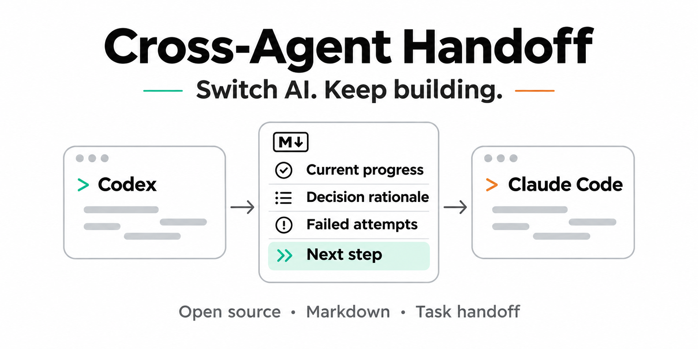
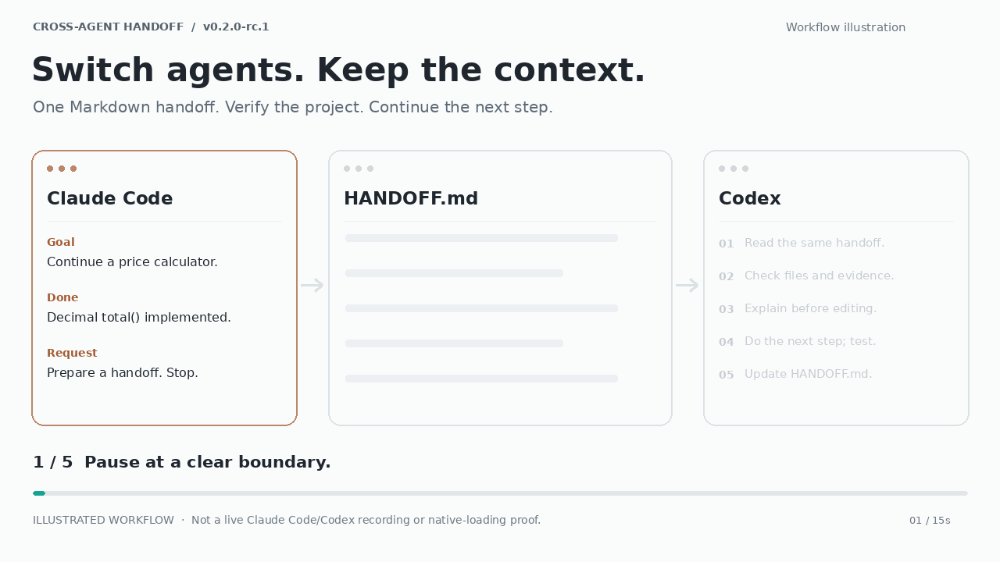
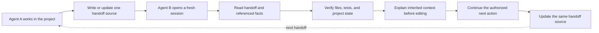
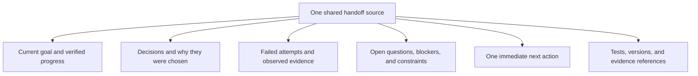

# Cross-Agent Handoff

[中文说明](README.zh-CN.md) · **v0.2.0-rc.1** · MIT · Pre-release candidate. See [validation and limitations](VALIDATION.md).

Cross-Agent Handoff is a lightweight, file-based workflow for passing unfinished work between AI agents. It preserves verified progress, decision rationale, failed attempts, open questions, and one next action in one shared project handoff source—usually `HANDOFF.md`, or an existing state document when the project already has one. The receiving agent checks the real project before editing. The Markdown workflow needs no server or runtime dependency.

## One-line install

Run from your target project root (macOS/Linux, POSIX shell; fresh installation):

**Claude Code**

```sh
cah_src=$(mktemp -d) && git clone --depth 1 --branch v0.2.0-rc.1 https://github.com/bray8en-ux/cross-agent-handoff.git "$cah_src" && mkdir -p .claude/skills && test ! -e .claude/skills/cross-agent-handoff && test ! -L .claude/skills/cross-agent-handoff && cp -R "$cah_src/skills/cross-agent-handoff" .claude/skills/
```

**Codex**

```sh
cah_src=$(mktemp -d) && git clone --depth 1 --branch v0.2.0-rc.1 https://github.com/bray8en-ux/cross-agent-handoff.git "$cah_src" && mkdir -p .agents/skills && test ! -e .agents/skills/cross-agent-handoff && test ! -L .agents/skills/cross-agent-handoff && cp -R "$cah_src/skills/cross-agent-handoff" .agents/skills/
```

Choose one command for your host. An existing installation stops the copy; use the full guide to upgrade. Open a fresh host session and invoke `/cross-agent-handoff` in Claude Code or `$cross-agent-handoff` in Codex.

For Windows, ZIP checksums, user-level installation, removal and rollback, see [INSTALL.md](INSTALL.md). Download: [ZIP](https://github.com/bray8en-ux/cross-agent-handoff/releases/download/v0.2.0-rc.1/cross-agent-handoff-v0.2.0-rc.1.zip) · [SHA256](https://github.com/bray8en-ux/cross-agent-handoff/releases/download/v0.2.0-rc.1/cross-agent-handoff-v0.2.0-rc.1.zip.sha256) · [Release notes](https://github.com/bray8en-ux/cross-agent-handoff/releases/tag/v0.2.0-rc.1).

## The handoff in 15 seconds



Illustrated workflow, not a live Claude Code/Codex recording or proof of native loading.

## What it is — and what it is not

**It is:** a small, reusable handoff protocol and Skill that helps one agent leave another agent enough verified project context to continue work without replaying the old chat.

**It is not:** full chat-history synchronization, native session migration, a background monitor, a multi-agent orchestrator, or a tool that launches or controls other agents.

Use it when work is paused, handed to another agent, moved to a fresh session, or resumed after a context reset. Keep the handoff in the project's existing source of truth when one already exists; do not create a parallel status file just to satisfy a filename convention.

## How the handoff works



### What should be handed off?



The handoff is a **curated task snapshot**, not a transcript dump. Record only relevant context, distinguish facts from assumptions, and save evidence before linking to it.

## Quick start

1. Make sure both agents can access the same project files. Cross-Agent Handoff does not sync files between devices.
2. Install the Skill for each local host, or use the [manual method](#manual-use) without installation.
3. In the current agent, explicitly request a handoff:

   ```text
   Use Cross-Agent Handoff in handoff mode.
   Read the project instructions and existing state documents first.
   Update the single existing handoff source with verified progress,
   decisions and rationale, failed attempts, open questions, evidence,
   and one next action. Do not create a parallel status document.
   Do not continue implementation in this turn; stop after verifying the handoff.
   ```

4. Open the same project in a fresh session with the receiving agent and request a resume:

   ```text
   Use Cross-Agent Handoff in resume mode.
   Read the existing handoff and its referenced evidence; do not rely on the old chat.
   Verify the actual project state. Before editing, explain what was done,
   why the current approach was chosen, what failed, what remains open,
   and the next action. Then continue only the authorized unfinished work.
   Update the same handoff source when the work is complete.
   ```

5. Review the receiving agent's explanation and changes. A successful file copy or a completed coding task alone does not prove native Skill loading or context inheritance.

### Example: a desktop companion project

Agent A finishes an interaction slice and records why it chose the current input approach, which alternative failed, what the tests actually prove, and which user-experience checks remain. Agent B reads the project's handoff and existing governance files, verifies the implementation, avoids reopening rejected approaches, and continues with the next authorized acceptance task. If the project already uses `CURRENT_STATE.md` as its status source, the handoff can be recorded there instead of creating a second `HANDOFF.md`.


## Manual use

Without installation, ask your agent to read [SKILL.md](skills/cross-agent-handoff/SKILL.md) and its needed references, then request handoff mode. It should reuse the project's existing state document when appropriate; otherwise it can create one `HANDOFF.md`. To resume, ask the next agent to read that same source, inspect the project, explain the inherited context, and continue only the authorized unfinished task. Save evidence before linking it. A pause request means save the necessary snapshot and stop. See the [template](skills/cross-agent-handoff/assets/HANDOFF.template.md) and [quality checklist](skills/cross-agent-handoff/references/quality-check.md).

## FAQ

- **Skill absent from the platform list?** Check the complete folder, chosen project/user scope, permissions, actual local host/session type and same-named copies. Start a new host conversation. Do not guess another platform's directory or change global settings automatically.
- **Why isn't a successful install proof of native loading?** Matching files prove the copy; only the host can show it selected and read that copy.
- **Must I reinstall after switching agents?** Each native host needs its own supported installation. The same project HANDOFF.md remains the fact source. Explicit file reading may avoid installation entirely.
- **Will upgrade overwrite HANDOFF.md?** No: only the selected Skill directory is replaced. Never point install to the project root.
- **How do I go back?** Keep the old full Skill backup, use [Rollback](INSTALL.md#rollback) and verify a fresh host session. Keep project evidence.

## Limits, validation and license

Windows file operations are tested only in synthetic project/user roots; macOS/Linux commands are statically reviewed and NOT TESTED on those operating systems. Native loading: **NOT TESTED**. Full chat migration, native state conversion, B1 extraction, cross-device synchronization and CLI orchestration are absent. There is no background watcher or lifecycle-event registration. Semantic discovery depends on real host metadata loading; no unconditional automatic trigger is promised. A platform mention alone does not request adaptation.

See [historical validation and retained limits](VALIDATION.md), [release notes](RELEASE_NOTES.md), [changes](CHANGELOG.md), and [MIT LICENSE](LICENSE). Historical NOT VERIFIED / NOT RUN items remain unchanged; the existing validation limitations remain unchanged.

