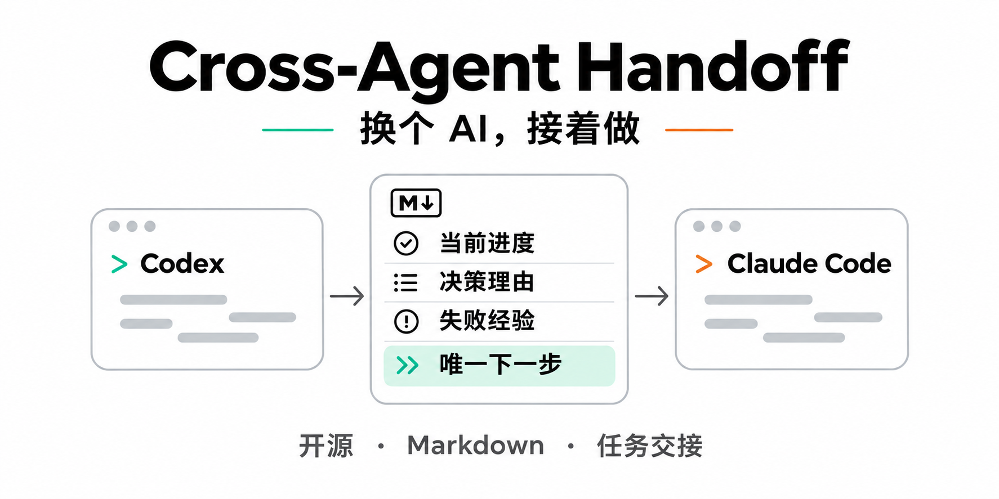
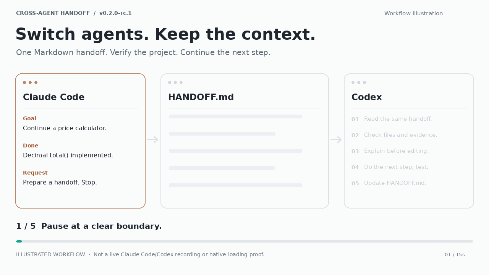
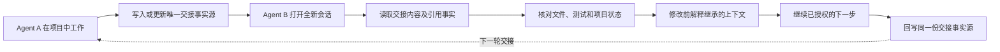
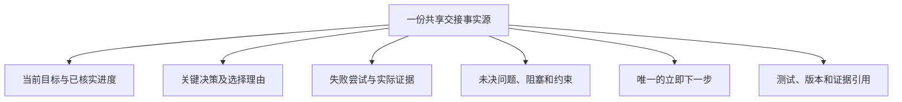

# Cross-Agent Handoff

[English](README.md) · **v0.2.0-rc.1** · MIT · GitHub 预发布候选版；测试范围与限制见 [VALIDATION.md](VALIDATION.md)。

Cross-Agent Handoff 是一套轻量、基于文件的 AI Agent 任务交接协议与 Skill。它把已核实的进度、决策理由、失败尝试、未决问题和唯一下一步保存在项目唯一的交接事实源中——通常是 `HANDOFF.md`；如果项目已经使用 `CURRENT_STATE.md`、任务卡或其他状态文档，则优先复用，不另建平行事实源。接收端先核对项目实物并解释继承的上下文，再继续已授权工作。Markdown 工作流无需服务器或运行时依赖。

## 一句话安装

在目标项目根目录运行（macOS/Linux、POSIX shell；全新安装）：

**Claude Code**

```sh
cah_src=$(mktemp -d) && git clone --depth 1 --branch v0.2.0-rc.1 https://github.com/bray8en-ux/cross-agent-handoff.git "$cah_src" && mkdir -p .claude/skills && test ! -e .claude/skills/cross-agent-handoff && test ! -L .claude/skills/cross-agent-handoff && cp -R "$cah_src/skills/cross-agent-handoff" .claude/skills/
```

**Codex**

```sh
cah_src=$(mktemp -d) && git clone --depth 1 --branch v0.2.0-rc.1 https://github.com/bray8en-ux/cross-agent-handoff.git "$cah_src" && mkdir -p .agents/skills && test ! -e .agents/skills/cross-agent-handoff && test ! -L .agents/skills/cross-agent-handoff && cp -R "$cah_src/skills/cross-agent-handoff" .agents/skills/
```

选择对应宿主的一条命令即可；已有安装会停止，升级时按完整指南操作。随后开启新会话，Claude Code 输入 `/cross-agent-handoff`，Codex 输入 `$cross-agent-handoff`。

Windows、ZIP 校验、用户级安装、卸载与回滚见 [INSTALL.zh-CN.md](INSTALL.zh-CN.md)。下载：[ZIP](https://github.com/bray8en-ux/cross-agent-handoff/releases/download/v0.2.0-rc.1/cross-agent-handoff-v0.2.0-rc.1.zip) · [SHA256](https://github.com/bray8en-ux/cross-agent-handoff/releases/download/v0.2.0-rc.1/cross-agent-handoff-v0.2.0-rc.1.zip.sha256) · [Release 说明](https://github.com/bray8en-ux/cross-agent-handoff/releases/tag/v0.2.0-rc.1)。

## 15 秒看懂交接



这是流程示意动画，不是 Claude Code/Codex 实机录屏，也不证明原生加载。

## 项目定位：它是什么，不是什么

**它是什么：** 一套轻量、可复用的交接协议，帮助一个 Agent 把另一个 Agent 接着完成工作所需的、经过核实的项目上下文留下来，不必重放旧聊天。

**它不是什么：** 完整聊天记录同步工具、原生会话迁移工具、后台监听器、多 Agent 编排器，也不会启动或控制其他 Agent。

适合用于：任务暂停、切换 Agent、开启新会话、上下文压缩后恢复工作。项目已经有自己的状态事实源时，优先复用它；不要为了满足文件名约定而额外制造第二套进度文档。

## 工作流程示意图



### 交接时应该保留什么？



交接文件是**经过整理的任务快照**，不是整段聊天记录导出。只保留与当前任务有关的信息，区分事实与推断，并且先保存证据、再引用证据。

## 快速上手

1. 确保两个 Agent 都能访问同一个项目目录。Cross-Agent Handoff 本身不负责跨设备同步文件。
2. 在每个本地宿主安装 Skill；也可以先用[手动方式](#手动使用)，不安装也能运行核心 Markdown 流程。
3. 在当前 Agent 中明确要求交接：

   ```text
   使用 Cross-Agent Handoff 的交接模式。
   先读取项目规则和已有状态文档。
   更新项目唯一的交接事实源，记录已核实进度、决策及理由、失败尝试、
   未决问题、证据和唯一下一步。不要创建第二套状态文档。
   本轮只做交接，不继续开发；核对交接文件后停止。
   ```

4. 用接收 Agent 在同一个项目中开启全新会话，要求接续：

   ```text
   使用 Cross-Agent Handoff 的接续模式。
   读取现有交接文件及其引用证据，不依赖旧聊天记录。
   核对真实项目状态。修改前先解释：已经完成什么、为什么采用当前方案、
   哪些尝试失败、还有什么未决问题，以及唯一下一步。
   然后只继续已授权的未完成工作，完成后回写同一份交接事实源。
   ```

5. 检查接收 Agent 的理解和实际改动。文件复制成功或代码任务完成，本身不等于原生 Skill 加载或上下文继承已得到证明。

### 示例：桌面陪伴插件项目

Agent A 完成一段交互功能后，记录当前输入方案的选择理由、哪种替代方案曾失败、测试实际证明了什么，以及还需要人工验收的体验项目。Agent B 读取项目交接文件和既有治理资料，核对实际实现，避免重新尝试已被否决的路线，并继续下一项已授权的验收任务。如果项目原本就用 `CURRENT_STATE.md` 维护状态，就可以直接在那里追加交接内容，而不必另建第二份 `HANDOFF.md`。


## 手动使用

可以不安装：让 AI 读取 [SKILL.md](skills/cross-agent-handoff/SKILL.md) 及必要引用，再明确要求进入交接模式。它应优先复用项目现有状态文档；没有合适入口时才创建一份 `HANDOFF.md`。恢复时要求下一个 Agent 读取同一份交接事实源、核对现场、解释继承的上下文，再继续已授权的未完任务。先保存证据再引用；暂停时保存必要快照后停止。参见[模板](skills/cross-agent-handoff/assets/HANDOFF.template.md)和[质量清单](skills/cross-agent-handoff/references/quality-check.md)。

## 常见问题

- **Skill 没出现在平台列表？** 核对完整目录、项目/用户作用域、权限、本地宿主/会话形态及同名副本，再新开会话。不要猜其他平台目录或自动改全局配置。
- **为何安装成功不等于原生加载已验证？** 文件一致只证明复制成功；需要宿主实际选择并读取该副本的结果。
- **更换 Agent 需重新安装？** 原生用法各宿主需要自己的支持入口，项目仍共用同一 HANDOFF.md；显式读文件可以完全不安装。
- **升级会覆盖 HANDOFF.md 吗？** 不会，目标只指向 Skill 目录；不得将 install 设为项目根。
- **如何回退旧版？** 保留完整旧 Skill 备份，执行回滚，并在新宿主会话核对；保留项目证据。

## 限制、验证与许可

Windows 文件操作仅在虚构项目/用户根验证；macOS/Linux 命令经过静态审查，在对应操作系统为 NOT TESTED。Native loading：**NOT TESTED**。未实现完整聊天迁移、原生状态转换、B1 提取、跨设备同步或 CLI 编排；没有后台监听或生命周期事件注册。语义发现依赖宿主实际加载元数据，不承诺无条件自动触发；只提平台名不触发适配。

参见[历史验收与限制](VALIDATION.md)、[版本说明](RELEASE_NOTES.md)、[变更](CHANGELOG.md)和 [MIT LICENSE](LICENSE)。历史 NOT VERIFIED / NOT RUN 保持原口径；原有验证边界保持不变。

