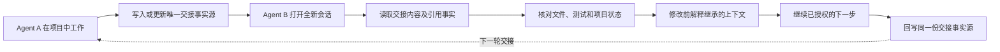
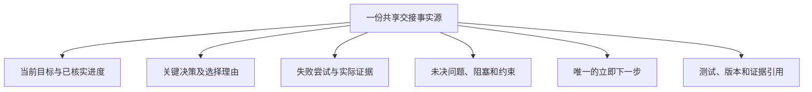

# Cross-Agent Handoff

[English](README.md) · **v0.2.0-rc.1** · MIT · GitHub 预发布候选版；测试范围与限制见 [VALIDATION.md](VALIDATION.md)。

Cross-Agent Handoff 是一套轻量、基于文件的 AI Agent 任务交接协议与 Skill。它把已核实的进度、决策理由、失败尝试、未决问题和唯一下一步保存在项目唯一的交接事实源中——通常是 `HANDOFF.md`；如果项目已经使用 `CURRENT_STATE.md`、任务卡或其他状态文档，则优先复用，不另建平行事实源。接收端先核对项目实物并解释继承的上下文，再继续已授权工作。Markdown 工作流无需服务器或运行时依赖。

## 项目定位：它是什么，不是什么

**它是什么：** 一套轻量、可复用的交接协议，帮助一个 Agent 把另一个 Agent 接着完成工作所需的、经过核实的项目上下文留下来，不必重放旧聊天。

**它不是什么：** 完整聊天记录同步工具、原生会话迁移工具、后台监听器、多 Agent 编排器，也不会启动或控制其他 Agent。

适合用于：任务暂停、切换 Agent、开启新会话、上下文压缩后恢复工作。项目已经有自己的状态事实源时，优先复用它；不要为了满足文件名约定而额外制造第二套进度文档。

## 工作流程示意图



### 交接时应该保留什么？



交接文件是**经过整理的任务快照**，不是整段聊天记录导出。只保留与当前任务有关的信息，区分事实与推断，并且先保存证据、再引用证据。

## 快速上手

1. 确保两个 Agent 都能访问同一个项目目录。Cross-Agent Handoff 本身不负责跨设备同步文件。
2. 在每个本地宿主安装 Skill；也可以先用[手动方式](#手动使用)，不安装也能运行核心 Markdown 流程。
3. 在当前 Agent 中明确要求交接：

   ```text
   使用 Cross-Agent Handoff 的交接模式。
   先读取项目规则和已有状态文档。
   更新项目唯一的交接事实源，记录已核实进度、决策及理由、失败尝试、
   未决问题、证据和唯一下一步。不要创建第二套状态文档。
   本轮只做交接，不继续开发；核对交接文件后停止。
   ```

4. 用接收 Agent 在同一个项目中开启全新会话，要求接续：

   ```text
   使用 Cross-Agent Handoff 的接续模式。
   读取现有交接文件及其引用证据，不依赖旧聊天记录。
   核对真实项目状态。修改前先解释：已经完成什么、为什么采用当前方案、
   哪些尝试失败、还有什么未决问题，以及唯一下一步。
   然后只继续已授权的未完成工作，完成后回写同一份交接事实源。
   ```

5. 检查接收 Agent 的理解和实际改动。文件复制成功或代码任务完成，本身不等于原生 Skill 加载或上下文继承已得到证明。

### 示例：桌面陪伴插件项目

Agent A 完成一段交互功能后，记录当前输入方案的选择理由、哪种替代方案曾失败、测试实际证明了什么，以及还需要人工验收的体验项目。Agent B 读取项目交接文件和既有治理资料，核对实际实现，避免重新尝试已被否决的路线，并继续下一项已授权的验收任务。如果项目原本就用 `CURRENT_STATE.md` 维护状态，就可以直接在那里追加交接内容，而不必另建第二份 `HANDOFF.md`。


## 手动使用

可以不安装：让 AI 读取 [SKILL.md](skills/cross-agent-handoff/SKILL.md) 及必要引用，再明确要求进入交接模式。它应优先复用项目现有状态文档；没有合适入口时才创建一份 `HANDOFF.md`。恢复时要求下一个 Agent 读取同一份交接事实源、核对现场、解释继承的上下文，再继续已授权的未完任务。先保存证据再引用；暂停时保存必要快照后停止。参见[模板](skills/cross-agent-handoff/assets/HANDOFF.template.md)和[质量清单](skills/cross-agent-handoff/references/quality-check.md)。

## 安装指南

### 前提与支持平台

需要能访问项目文件、支持 Skill 的本地宿主。Windows 命令要求 PowerShell 7+；macOS/Linux 要求 POSIX shell、unzip、shasum、awk、diff 和常规文件工具。这些只是安装工具，不是工作流运行依赖。通过可信渠道取得 ZIP 和校验值；不假设已有公开仓库地址。

| 本地宿主 | 项目级路径 | 用户级默认路径 | 宿主会话内入口 |
| --- | --- | --- | --- |
| Claude Code | `.claude/skills/cross-agent-handoff/` | `~/.claude/skills/cross-agent-handoff/` | `/cross-agent-handoff` |
| Codex | `.agents/skills/cross-agent-handoff/` | `~/.agents/skills/cross-agent-handoff/` | `$cross-agent-handoff` |

路径已对照 [Claude Code 官方文档](https://code.claude.com/docs/en/skills) 与 [OpenAI 官方文档](https://learn.chatgpt.com/docs/customization/overview)。这只是本地默认目录，不是其他产品通用路径；自定义/受管根目录和权限应核对实际宿主设置。Claude Cowork/云会话不一定像本地 Claude Code 一样读取这些本机目录。其他平台没有已验证的原生安装目录，可在文件可访问时显式读取 Markdown；不编造路径。参见[平台参考](skills/cross-agent-handoff/references/platforms.md)。

### 手动 ZIP 安装

把下载 ZIP 及相邻 `.zip.sha256` 放在目标项目之外的工作区，并在那里运行。来自同一不可信来源的校验值不能证明真实性；应通过可信发布渠道确认预期值。

Windows PowerShell 7+:

```powershell
# CAH:zip
$ErrorActionPreference = 'Stop'
$zip = (Resolve-Path './cross-agent-handoff-v0.2.0-rc.1.zip').Path
$expected = ((Get-Content -LiteralPath ($zip + '.sha256') -Raw).Trim() -split '\s+')[0]
if ((Get-FileHash -LiteralPath $zip -Algorithm SHA256).Hash.ToLowerInvariant() -ne $expected.ToLowerInvariant()) { throw 'ZIP hash mismatch' }
$unpack = Join-Path (Get-Location).Path 'cah-unpacked'
if (Test-Path -LiteralPath $unpack) { throw 'Choose a new empty extraction destination' }
Expand-Archive -LiteralPath $zip -DestinationPath $unpack
Get-Item -LiteralPath (Join-Path $unpack 'cross-agent-handoff-v0.2.0-rc.1/skills/cross-agent-handoff/SKILL.md')
```

macOS / Linux (POSIX shell):

```sh
# CAH:zip
set -eu
zip='./cross-agent-handoff-v0.2.0-rc.1.zip'
expected=$(awk 'NR==1 {print $1}' "$zip.sha256")
actual=$(shasum -a 256 "$zip" | awk '{print $1}')
[ "$actual" = "$expected" ] || { echo 'ZIP hash mismatch' >&2; exit 1; }
[ ! -e './cah-unpacked' ] || { echo 'Choose a new extraction destination' >&2; exit 1; }
unzip -q "$zip" -d './cah-unpacked'
test -f './cah-unpacked/cross-agent-handoff-v0.2.0-rc.1/skills/cross-agent-handoff/SKILL.md' 
```

### 项目级安装与用户级安装

示例假设工作区下的 cah-unpacked/ 与目标项目为同级目录。在目标项目根打开 shell；agent 选择 claude 或 codex，scope 选择 project 或 user，按需要调整包的相对路径。用户级对该宿主本机各项目生效，项目级只针对本项目。必须复制整个 Skill 目录，不能只复制 SKILL.md。下面定义后续复用的变量和守卫函数；新开 shell 需重跑设置。路径及祖先含符号链接/junction 时停止，避免删除或替换越过目标范围。

Windows PowerShell 7+:

```powershell
# CAH:setup
$ErrorActionPreference = 'Stop'
# Run in your target project root. Edit these three settings.
$agent = 'claude'       # claude | codex
$scope = 'project'      # project | user
$package = (Resolve-Path '../cah-unpacked/cross-agent-handoff-v0.2.0-rc.1').Path
$project = (Get-Location).Path
$userRoot = [Environment]::GetFolderPath('UserProfile')
if ($agent -notin @('claude','codex') -or $scope -notin @('project','user')) { throw 'Invalid agent/scope' }
$base = if ($scope -eq 'project') { $project } else { $userRoot }
$relativeRoot = if ($agent -eq 'claude') { '.claude/skills' } else { '.agents/skills' }
$skillsRoot = [IO.Path]::GetFullPath((Join-Path $base $relativeRoot))
$install = Join-Path $skillsRoot 'cross-agent-handoff'
$source = Join-Path $package 'skills/cross-agent-handoff'
function Assert-CahTarget {
    if ([IO.Path]::GetFullPath($install) -cne (Join-Path $skillsRoot 'cross-agent-handoff')) { throw 'Unexpected removal/replacement target' }
    $cursor = $install
    while ($cursor) {
        if (Test-Path -LiteralPath $cursor) {
            if ((Get-Item -LiteralPath $cursor -Force).Attributes -band [IO.FileAttributes]::ReparsePoint) { throw 'Linked target/ancestor: inspect manually' }
        }
        $cahParent = [IO.Directory]::GetParent($cursor)
        $cursor = if ($null -eq $cahParent) { $null } else { $cahParent.FullName }
    }
}
function Assert-CahSource {
    foreach ($rel in @('SKILL.md','LICENSE','assets/HANDOFF.template.md','references/platforms.md','references/quality-check.md')) {
        if (-not (Test-Path -LiteralPath (Join-Path $source $rel) -PathType Leaf)) { throw "Missing source resource: $rel" }
    }
}
function Test-CahInstalled {
    Assert-CahTarget
    $left = @(Get-ChildItem -LiteralPath $source -Recurse -File | ForEach-Object { [IO.Path]::GetRelativePath($source,$_.FullName) } | Sort-Object)
    $right = @(Get-ChildItem -LiteralPath $install -Recurse -File | ForEach-Object { [IO.Path]::GetRelativePath($install,$_.FullName) } | Sort-Object)
    if (Compare-Object $left $right) { throw 'Installed file set differs' }
    foreach ($rel in $left) {
        if ((Get-FileHash -LiteralPath (Join-Path $source $rel)).Hash -ne (Get-FileHash -LiteralPath (Join-Path $install $rel)).Hash) { throw "Hash differs: $rel" }
    }
    Select-String -LiteralPath (Join-Path $install 'SKILL.md') -Pattern 'v0\.2\.0-rc\.1'
}
Assert-CahTarget
Assert-CahSource
Write-Output "Selected installation only: $install"
```

macOS / Linux (POSIX shell):

```sh
# CAH:setup
set -eu
# Run in your target project root. Edit these three settings.
agent='claude'           # claude | codex
scope='project'          # project | user
package=$(cd '../cah-unpacked/cross-agent-handoff-v0.2.0-rc.1' && pwd -P)
project=$(pwd -P)
user_root=$(cd "$HOME" && pwd -P)
case "$scope" in project) base="$project" ;; user) base="$user_root" ;; *) exit 1 ;; esac
case "$agent" in claude) skills_root="$base/.claude/skills" ;; codex) skills_root="$base/.agents/skills" ;; *) exit 1 ;; esac
install="$skills_root/cross-agent-handoff"
source="$package/skills/cross-agent-handoff"
guard_target() {
    [ "$install" = "$skills_root/cross-agent-handoff" ] || return 1
    cah_parent="$install"
    while [ "$cah_parent" != '/' ]; do
        [ ! -L "$cah_parent" ] || { echo 'Linked target/ancestor: inspect manually' >&2; return 1; }
        cah_parent=$(dirname "$cah_parent")
    done
}
check_source() {
    for cah_rel in SKILL.md LICENSE assets/HANDOFF.template.md references/platforms.md references/quality-check.md; do
        test -f "$source/$cah_rel" || return 1
    done
}
check_installed() {
    guard_target
    diff -qr "$source" "$install"
    grep -n 'v0.2.0-rc.1' "$install/SKILL.md"
}
guard_target
check_source
printf 'Selected installation only: %s\n' "$install"
```

全新安装运行以下段落。目标已存在则停止，使用升级步骤，不能直接合并目录。目标不得设为项目根或 skills 父目录。

Windows PowerShell 7+:

```powershell
# CAH:install
Assert-CahTarget
Assert-CahSource
if (Test-Path -LiteralPath $install) { throw 'Already installed: use Upgrade, do not merge directories' }
New-Item -ItemType Directory -Path $skillsRoot -Force | Out-Null
Copy-Item -LiteralPath $source -Destination $install -Recurse
Test-CahInstalled
```

macOS / Linux (POSIX shell):

```sh
# CAH:install
guard_target
check_source
[ ! -e "$install" ] || { echo 'Already installed: use Upgrade' >&2; exit 1; }
mkdir -p "$skills_root"
cp -R "$source" "$install"
check_installed
```

### 安装验证

上面的验证比较安装目录全部文件的清单和内容，并显示版本。它只证明文件复制，不能证明宿主已加载。在正确项目中新开本地宿主会话，显式使用表格入口，确认能读取模板和参考文件；入口是在会话里输入，不是 shell 命令。认证、信任、宿主版本、同名优先级和文件权限仍会影响加载。本轮文档修复的原生宿主加载为 NOT TESTED。

## 卸载指南

沿用上述设置，先确认打印的精确目标与文件清单。命令只删除所选宿主/作用域的 cross-agent-handoff 目录；若还装有另一份，需要显式切换宿主/作用域后重跑设置。不要删除 skills 父目录、项目根、源码、HANDOFF.md、任务状态或历史交接。如果曾人工添加薄规则入口，只移除已识别的该条引用，保留其他规则；这些命令本身不创建规则入口。卸载后用新宿主会话核对；另一份安装仍可能被选择。

Windows PowerShell 7+:

```powershell
# CAH:remove
Assert-CahTarget
if (-not (Test-Path -LiteralPath (Join-Path $install 'SKILL.md') -PathType Leaf)) { throw 'Selected Skill is not present' }
Write-Output "Remove only: $install"
Get-ChildItem -LiteralPath $install -Recurse -File
Remove-Item -LiteralPath $install -Recurse -ErrorAction Stop
if (Test-Path -LiteralPath $install) { throw 'Skill removal incomplete' }
```

macOS / Linux (POSIX shell):

```sh
# CAH:remove
guard_target
test -f "$install/SKILL.md"
printf 'Remove only: %s\n' "$install"
find "$install" -type f
rm -r -- "$install"
test ! -e "$install"
```

## 升级指南

1. 核对实际加载位置、当前版本/哈希，先排除多份同名安装。
2. 按手动 ZIP 步骤获取并核验新版，使用其真实文件名/校验文件和新解压目录，检查完整资源。重新执行设置，使 package 指向新版包；不要再运行全新安装段。
3. 先检查本地定制，保留并人工合并，不能静默覆盖。以下把旧 Skill 整体移入发现目录之外的唯一备份，再复制完整新版并验证。保存打印的备份路径及旧哈希。

Windows PowerShell 7+:

```powershell
# CAH:upgrade
Assert-CahTarget
Assert-CahSource
$oldHash = (Get-FileHash -LiteralPath (Join-Path $install 'SKILL.md')).Hash
Select-String -LiteralPath (Join-Path $install 'SKILL.md') -Pattern 'v0\.'
$backupRoot = Join-Path $base '.cah-skill-backups'
New-Item -ItemType Directory -Path $backupRoot -Force | Out-Null
$backup = Join-Path $backupRoot ('cross-agent-handoff-' + [Guid]::NewGuid().ToString('N'))
if (Test-Path -LiteralPath $backup) { throw 'Backup destination exists' }
Move-Item -LiteralPath $install -Destination $backup
Copy-Item -LiteralPath $source -Destination $install -Recurse
Test-CahInstalled
Write-Output "Keep for rollback: $backup ; old SKILL SHA256: $oldHash"
```

macOS / Linux (POSIX shell):

```sh
# CAH:upgrade
guard_target
check_source
old_hash=$(shasum -a 256 "$install/SKILL.md" | awk '{print $1}')
grep -n 'v0\.' "$install/SKILL.md" || true
mkdir -p "$base/.cah-skill-backups"
backup_parent=$(mktemp -d "$base/.cah-skill-backups/upgrade.XXXXXXXX")
backup="$backup_parent/cross-agent-handoff"
mv "$install" "$backup"
cp -R "$source" "$install"
check_installed
printf 'Keep for rollback: %s ; old SKILL SHA256: %s\n' "$backup" "$old_hash"
```

4. 新开宿主会话确认加载预期版本；文件验证不能代替。复制或验证失败时保留备份，按下文回滚，不继续使用不完整安装。备份不混入发布 ZIP。

### 回滚

同一 shell 执行以下步骤，先保留新版/部分安装，再恢复旧目录。若已关闭 shell，重跑设置并将 PowerShell 的 backup/oldHash，或 POSIX 的 backup/backup_parent/old_hash 设为之前打印保存的精确值，检查后再用；不能猜测或删除备份。最后核对旧文件，并在新宿主会话验证旧版加载。另见 [ROLLBACK.md](ROLLBACK.md)。

Windows PowerShell 7+:

```powershell
# CAH:rollback
Assert-CahTarget
if (-not (Test-Path -LiteralPath (Join-Path $backup 'SKILL.md') -PathType Leaf)) { throw 'Backup missing; select the exact saved backup' }
$replaced = $backup + '.replaced'
if (Test-Path -LiteralPath $replaced) { throw 'Rollback preservation destination exists' }
if (Test-Path -LiteralPath $install) { Move-Item -LiteralPath $install -Destination $replaced }
Move-Item -LiteralPath $backup -Destination $install
if ((Get-FileHash -LiteralPath (Join-Path $install 'SKILL.md')).Hash -ne $oldHash) { throw 'Restored version hash differs' }
```

macOS / Linux (POSIX shell):

```sh
# CAH:rollback
guard_target
test -f "$backup/SKILL.md"
replaced="$backup_parent/replaced"
test ! -e "$replaced"
if [ -e "$install" ]; then mv "$install" "$replaced"; fi
mv "$backup" "$install"
restored_hash=$(shasum -a 256 "$install/SKILL.md" | awk '{print $1}')
test "$restored_hash" = "$old_hash"
```

安装、升级和卸载都只针对 Skill 自身目录，不覆盖项目 HANDOFF.md、源码或历史交接；不改账号、全局 Hook 或平台 Adapter。

## 常见问题

- **Skill 没出现在平台列表？** 核对完整目录、项目/用户作用域、权限、本地宿主/会话形态及同名副本，再新开会话。不要猜其他平台目录或自动改全局配置。
- **为何安装成功不等于原生加载已验证？** 文件一致只证明复制成功；需要宿主实际选择并读取该副本的结果。
- **更换 Agent 需重新安装？** 原生用法各宿主需要自己的支持入口，项目仍共用同一 HANDOFF.md；显式读文件可以完全不安装。
- **升级会覆盖 HANDOFF.md 吗？** 不会，目标只指向 Skill 目录；不得将 install 设为项目根。
- **如何回退旧版？** 保留完整旧 Skill 备份，执行回滚，并在新宿主会话核对；保留项目证据。

## 限制、验证与许可

Windows 文件操作仅在虚构项目/用户根验证；macOS/Linux 命令经过静态审查，在对应操作系统为 NOT TESTED。没有启动原生宿主。未实现完整聊天迁移、原生状态转换、B1 提取、跨设备同步或 CLI 编排；没有后台监听或生命周期事件注册。语义发现依赖宿主实际加载元数据，不承诺无条件自动触发；只提平台名不触发适配。

参见[历史验收与限制](VALIDATION.md)、[版本说明](RELEASE_NOTES.md)、[变更](CHANGELOG.md)和 [MIT LICENSE](LICENSE)。历史 NOT VERIFIED / NOT RUN 保持原口径；本文档修复候选发布前需最终复审。
